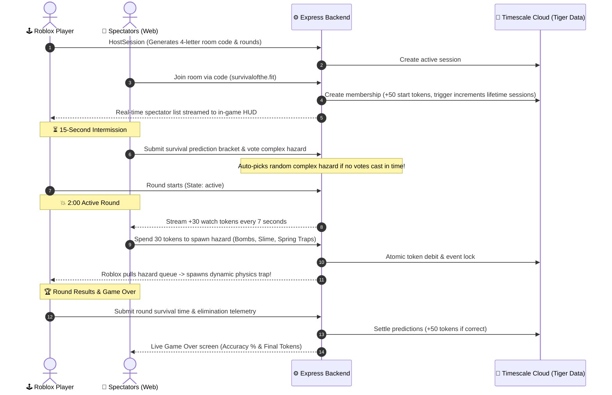

# Crowd Control 🎮💥
> **SwampHacks XII Submission**  
> *A live, cross-platform audience participation survival game bridging Roblox and mobile web.*

[](https://survivalofthe.fit)
[](https://api.survivalofthe.fit/health)
[](https://www.roblox.com)
[-FDB515?style=for-the-badge&logo=postgresql&logoColor=black)](https://www.timescale.com/)
[](https://auth0.com)

---

## 📖 Overview

**Crowd Control** flips the traditional dynamic of gaming streams on its head. Instead of passively watching gameplay or typing into a delayed chat, spectators hold direct physical control over the game arena in real time from their smartphones.

One player enters a high-stakes survival arena in **Roblox**, fighting to stay alive on an elevated podium for up to 2 minutes per round. Meanwhile, an audience of spectators connects via **[survivalofthe.fit](https://survivalofthe.fit)** to bet on how long the player will survive, vote on game-breaking modifiers, and spend earned tokens to spawn physical traps, explosions, and physics hazards under the player's feet.

---

## ⚡ The Live Gameplay Loop



1. **Host Launches Arena:** The player presses "Play" in Roblox, selecting 5–10 rounds. A 4-letter session code and QR code appear on screen.
2. **Spectators Join:** Audience members scan the QR code or visit `survivalofthe.fit`, log in with passwordless Auth0, and enter the code. They are awarded **+50 starting tokens**.
3. **Live Lobby HUD:** Connected spectators immediately appear on the Roblox in-game spectator board in real time.
4. **15-Second Intermission:** Spectators vote on a global complex event (*Giant Boulder*, *Floor Is Lava*, *Tornado*, *Blob Fight*, *Tsunami*, *Flood Escape*, *Shrinking Podium*) and submit predictions on survival brackets (`0:00–0:15`, `0:15–0:30`, `0:30–0:45`, `0:45–1:00`). If no spectators vote before the timer expires, the backend automatically triggers a random complex event fallback so gameplay never stalls.
5. **Real-Time Havoc:** As the active round plays out, spectators spin an interactive hazard wheel on their phones. Tapping hazards spends 30 tokens to instantly drop physical bombs, spring traps, banana peels, or slime puddles into Roblox.
6. **Token Economy:** Spectators earn **+30 tokens every 7 seconds** of active gameplay, **+30 tokens** for every round survived, and **+50 tokens** for guessing the correct survival bracket.
7. **Game Over & Lifetime Stats:** The ending screen presents prediction accuracy percentage and final token balances, while persistent lifetime stats are saved to the player's profile in Tiger Data.

---

## 🛠️ Tech Stack & Architecture

| Layer | Technologies | Role & Purpose |
| :--- | :--- | :--- |
| **Game Engine & Physics** | **Roblox Engine + Luau** | 3D physics arena running player movement, hazard collisions, sound effects, and real-time spectator display. Polls the backend every 3s via `HttpService`. |
| **Spectator Frontend** | **React 19, TypeScript, Vite** | Mobile-first single-page web app hosted at `survivalofthe.fit`. Features responsive carousel event wheels, animated waiting rooms, and real-time polling sync. |
| **Backend API Bridge** | **Node.js 22, Express, TypeScript** | REST API hosted at `api.survivalofthe.fit`. Manages room state transitions (`lobby`, `intermission`, `active`, `results`), event queues, hazard cooldowns, and ledger settlements. |
| **Database & Telemetry** | **Timescale Cloud (Tiger Data) / PostgreSQL** | Relational session state + time-series telemetry. Uses PostgreSQL triggers for atomic lifetime stats and deterministic idempotency keys to eliminate double-spending. |
| **Security & Identity** | **Auth0 by Okta** | **Spectators:** Passwordless email & Google login issuing JWTs (`https://api.crowdcontrol`).<br>**Roblox Game Server:** Authenticates via Machine-to-Machine client credentials from Roblox Secrets. |
| **Cloud Hosting & DevOps** | **Vultr Cloud Compute, Nginx, Certbot** | Ubuntu cloud VPS hosting the Express service under `systemd`, reverse-proxied by Nginx with automated Let's Encrypt SSL/TLS encryption. |

---

## 🐯 Tiger Data (Timescale Cloud) Highlights

Crowd Control relies on **Timescale Cloud PostgreSQL** for persistent, auditable, and race-condition-free state management:

### 1. Automated PostgreSQL Triggers
Rather than computing lifetime stats in application code, Tiger Data handles aggregation atomically inside the database engine:
```sql
-- Automatically increments total sessions joined on membership creation
CREATE TRIGGER session_membership_count_lifetime_session
  AFTER INSERT ON session_memberships
  FOR EACH ROW EXECUTE FUNCTION update_spectator_lifetime_sessions();

-- Automatically updates balance and tracks lifetime tokens spent on purchases
CREATE TRIGGER token_ledger_lifetime_spend
  AFTER INSERT ON token_ledger
  FOR EACH ROW EXECUTE FUNCTION update_spectator_lifetime_spend();
```

### 2. Idempotent Double-Entry Token Ledger
Every token grant or spend is written to `token_ledger` with unique idempotency keys (e.g. `join-reward:session:user`, `interval-reward:session:round:interval:membership`). If a spectator suffers mobile network packet loss or refreshes their browser, rewards and purchases are guaranteed **never to duplicate**.

### 3. High-Frequency Telemetry
The `telemetry_events` table ingests time-stamped player elimination causes, survival duration metrics, and hazard execution logs for post-game analytics.

---

## 🔒 Security & Zero-Trust Architecture

* **No Hardcoded Secrets:** Private database credentials, server tokens, and Auth0 secrets are stored strictly in environment variables and Roblox Experience Secrets (`HttpService:GetSecret`).
* **JWT Audience Verification:** Every spectator API call requires an Auth0 Bearer token verified against `issuerBaseURL` and audience `https://api.crowdcontrol`.
* **Tamper-Proof Authorization:** Spectators cannot forge purchases or votes for another user; the backend enforces strict binding between the verified JWT `sub` and the database `spectator_id`.

---

## 📁 Repository Structure

```
crowd-control/
├── backend/               # Node.js + Express REST API
│   ├── db/                # PostgreSQL SQL migrations (001 - 004)
│   ├── src/               # Express server, routes, and auth middleware
│   └── src/server.test.ts # Comprehensive test suite (25/25 tests passing)
├── frontend/              # React 19 + TypeScript Spectator Web App (Vite)
│   ├── src/auth/          # Auth0 provider, panels, and profile services
│   ├── src/game/          # WaitingForHost, ComplexVote, BasicWheel, SessionEnd views
│   └── src/api/           # Type-safe backend API client
├── sync/                  # Roblox Studio game code (Azul / Rojo synced)
│   ├── ServerScriptService/ # RoundManager, BackendModule, EventsModule
│   ├── StarterGui/        # MainMenu, Lobby, SpectatorHUD, Ending controllers
│   └── Workspace/         # Physical arenas, hazards, and sound assets
├── shared/                # Canonical API contracts & event definitions
└── deploy-frontend.sh     # Automated Vultr Nginx + SSL deployment script
```

---

## 🚀 Local Development Setup

### 1. Backend Setup
```bash
cd backend
cp .env.example .env
# Add your DATABASE_URL in .env
npm install
npm run migrate
npm test
npm run dev
```

### 2. Frontend Setup
```bash
cd frontend
cp .env.example .env
# Add your Auth0 domain and client ID in .env
npm install
npm run dev
```

### 3. Production Deployment (Vultr)
```bash
# Automated deployment script builds frontend and configures Nginx + SSL:
sudo bash deploy-frontend.sh
```

---

## 👥 The Team

Built with passion for **SwampHacks XII** by:
* **Kush Palem** — Backend Architecture, Database Schema, & Cloud Infrastructure
* **Andy** — Roblox Game Simulation, Luau Physics, & In-Game UI
* **Diya** — Mobile Web Frontend, React UI/UX Design, & Animations

*Special thanks to the SwampHacks XII organizers and sponsors!*
